# DEAD WIRE — БЛЭК-КРИК (АПРЕЛЬ 1890): ГЛОБАЛЬНЫЙ ДИЗАЙН-ДОКУМЕНТ ГОРОДА, АРХИТЕКТУРЫ И ДНЕВНОГО ГЕЙМПЛЕЯ

**Статус:** Каноническая дизайн-библия этапов **M2–M3** (утверждается владельцем перед стартом M2-A).  
**Витринное название игры:** **FORM 19** *(внутренний код проекта и репозиторий: dead-wire)*  
**Связанные документы:** [`DEAD_WIRE_GDD_v1.0.md`](./DEAD_WIRE_GDD_v1.0.md), [`DEAD_WIRE_HORROR_LAYER_DESIGN.md`](./DEAD_WIRE_HORROR_LAYER_DESIGN.md), [`ACTIVE_ROADMAP.md`](../plans/next/ACTIVE_ROADMAP.md).  
**Цель документа:** задать единый архитектурный, исторический, визуальный, звуковой, геймплейный и технический фундамент длинной кампании **DEAD WIRE** (6 ночей + 6 дней + Воскресный суд, **6–10+ часов** игры), где тёплый, живой, солнечный дневной городок 1890 года в Скалистых горах Колорадо (с салуном, выпивкой, азартными играми, «спинами» и разговорами у бармена) контрастирует с тесной керосиновой темнотой ночных дежурств.

---

## 1. Видение и тональный контраст («Солнце и пыль днём — керосин и холод ночью»)

Главный драматургический рычаг **DEAD WIRE** — **контраст**:

- Если игра держит игрока 100% времени в сером тумане и мраке, глаз и нервы быстро притупляются.
- Когда же после холодной ночной вахты (00:00–06:00) и сырого рассветного возвращения домой Элиас просыпается под **ясным апрельским горным солнцем Колорадо**, выходит на оживлённую Главную улицу, заходит в тёплый, громкий от тапёрского пианино салун **«Медный Мул»**, пьёт виски за 10 центов, крутит латунный барабан автомата «Серебряная Шпора», ставит на «Фаро» и вытягивает слухи у бармена — мир ощущается живым, материальным и почти безопасным.
- Именно поэтому возвращение на станцию в сумерках и момент, когда за окном снова синеет ночь, а на проводе в 02:15 рука пишет не то, что отбил ключ, бьёт в десять раз сильнее.

### Триада референсов-ДНК

| Референс | Что берём в дневной Блэк-Крик | Граница реализма (что отсекаем) |
|---|---|---|
| **Red Dead Redemption 2** (*Valentine / Smithfield's Saloon*) | Весенняя распутица на широкой грунтовой улице, приподнятые дощатые тротуары, коновязи, тактильный ритуал у барной стойки, бармен как «память города», живая атмосфера азартных столов и перешёптываний посетителей. | Без открытого мира на километры, без драк и перестрелок, без симуляции охоты и выживания. |
| **JoJo's Bizarre Adventure: Steel Ball Run** *(буквально США, 1890 год)* | Солнечная охристо-лазурная палитра горного Запада, ощущение эпохи на пороге XX века (поезда, телеграф, механика), **яркие, запоминающиеся, эксцентричные персонажи** с чёткими силуэтами и мелкими личными привычками (кручение монеты на костяшках, чернильные манжеты, страсть к картам), высокое напряжение и **большой скрытый заговор компании** под внешне весёлым фронтиром. | Без сверхъестественных стендов, гротескного аниме-стиля и комедийного фарса: вся эксцентрика строго в рамках исторического 1890 года и стиля PSX (`Signalis` / `Crow Country` / `Mouthwashing`). |
| **DEAD WIRE (Ядро GDD)** | Наблюдение, ритм, проверка документа против реальности, раздельные `WorldState` и `KnowledgeState`. Дневные сплетни, газетные архивы, почта и ошибки шулера органично кормят ночную паранойю без квестовых восклицательных знаков. | Священные инварианты (`AGENTS.md`) нерушимы: лента пишет только `MARK/GAP`, Слушающий никогда не трогает предметы, нет шкалы «добра/зла». |

### Эволюция относительно раннего наброска `WS6_m2_town.md`

Ранний набросок `WS6_m2_town.md` (до финализации M1) предполагал крошечный 6-минутный сумрачный проход на ≤4 точки без диалогов и активностей. По новому утверждённому курсу:
1. Блэк-Крик — **полноценный компактный городок (140 × 75 м)**: **7 входимых интерьеров** (выпускаемых поэтапно) + **7 экстерьерных ориентиров/точек**.
2. В дневном контуре есть **живой салун, экономика центов и долларов 1890 года, выпивка, 3 азартные активности (включая «спины» на механическом стимуляторе 1890 года, Chuck-a-Luck и Фаро с поимкой шулера) и бармен-информатор**, реагирующий на ночные решения игрока.
3. Соблюдается анти-блоат дисциплина GDD §28: никаких пустых растянутых прерий и бессмысленных клонов комнат — каждый квадратный метр Главной улицы работает на атмосферу и игру, а города вводятся пофазно (**M2-A → M2-B1 → M2-B2 → M2-B3**) с показом владельцу после каждой фазы.

---

## 2. Историческая база (Колорадо, апрель 1890)

Все здания, цены, игры и музыка опираются на реальные прототипы горно-железнодорожных городков Колорадо эпохи Серебряного бума (**1885–1893**, за три года до серебряного краха 1893 г.):

### 2.1 Архитектурные прототипы Колорадо 1890-х
- **Silverton, CO (Blair Street vs. Greene Street):** немощёная грунтовая улица, деревянные настилы на сваях, двухэтажные салуны с ложными фасадами (*False Front*) и декоративными карнизами, отделённые от «приличных» конторских и жилых улиц.
- **Crested Butte, CO (Elk Avenue):** знаменитая **широкая центральная улица** (чтобы встречные грузовые фуры и повозки с рудой свободно разъезжались в распутицу), приглушённые земляные минеральные краски (охра, железисто-красный сурик, горчица, оливково-серый, выбеленный кедр) и вытянутые вдоль проезжей части навесы.
- **Georgetown & Leadville, CO:** каньонный рельеф с террасированными склонами; бревенчатые и дощатые хижины шахтёров (*board-and-batten*) на каменных подпорных стенках, викторианские пансионы с резными верандами, деревянные мосты через горный ручей талой воды.
- **Como, CO (South Park / D&RG):** классическое комбинированное железнодорожное депо с телеграфным эркером на пути, крутой крышей с широкими свесами от снега и деревянной водонапорной башней на тяжёлых брусьях.

### 2.2 Историческая экономика 1890 года (цены в центах)
- Жалованье железнодорожного телеграфиста в Колорадо (1890): **$45–$75/мес.** (~**$1.50–$2.50 за 12-часовую смену**; в Блэк-Крике базовая ставка за ночную смену = **$2.00 / 200¢**).
- Комната с питанием в пансионе (*Room & Board*): **$3.00–$5.00/нед.** (в Блэк-Крике — **$4.00** за половину недели, оплата миссис Харгроув на 4-й день).
- Пиво в розлив (*Draft Beer* + бесплатная закуска у стойки — *Free Lunch*: крекеры, сыр, маринованные яйца): **5¢** (один никель).
- Простой кукурузный виски (*House Corn Whiskey*): **10¢**. Выдержанный кентуккийский бурбон (*Top-Shelf Bourbon*): **25¢** («два бита»). Кофе / сарсапарилла: **5¢**.
- Газета *The Black Creek Chronicle*: **5¢**. Никелевый «спин» на барном автомате: **5¢** (крупная ставка: **25¢**).

### 2.3 Азартные игры и «спины» эпохи 1889–1891 гг.
В конце 1880-х — 1890 году на Западе США классические карточные столы делят зал салуна с ранними механическими **торговыми стимуляторами (*Trade Stimulators*)**:
1. **Контр-стимуляторы со спинами (1889–1891):** настольные шкафчики из четвертьраспиленного дуба и литой латуни с боковым пружинным рычагом, под которым за стеклом вращаются литографированные барабаны (или колесо с указателем). В реальной истории именно в 1889–1891 гг. появились предтечи слотов — стимуляторы Клемента Клоусона / Mills и 5-барабанный покерный аппарат Ситтмана и Питта (1891), которые из-за антиигорных законов часто выдавали не наличные напрямую, а **барные жетоны (*Trade Tokens*)**, сигары и бесплатные кружки у бармена — отсюда наш латунный настольный аппарат **«Серебряная Шпора» (*The Silver Spur*)**!
2. **Big Six / Колесо Фортуны:** вертикальное деревянно-латунное колесо со штырями и кожаным язычком-трещоткой (*clapper*), прибитое у азартного угла.
3. **Chuck-a-Luck (*Wire Birdcage*):** 3 кости внутри поворотной проволочной клетки в форме песочных часов на суконном мате с цифрами `1–6` и полем суммы `FIELD`.
4. **Faro (*«Укротить тигра» / Bucking the Tiger*):** главная карточная игра Дикого Запада № 1 (популярнее покера в 1880–1890 гг.!). Зелёное сукно со всеми 13 номиналами пик, латунная коробочка-шуз, выдача по две карты (**проигрышная + выигрышная**), медный жетон для ставки «на проигрыш» (*coppering the bet*) и деревянный **Кейскипер (*Casekeeper*)** — счёты с 4 бусинами на каждый номинал, по которым внимательный игрок отслеживает, не шулерствует ли крупье с «подпиленной» коробкой.

### 2.4 Музыка салуна (апрель 1890 — до расцвета классического рэгтайма 1899 г.)
- Вертикальное расстроенное пианино (*Tack / Honky-Tonk Piano*): живые **кейк-уоки (*Cakewalks*)**, сентиментальные **фронтирные вальсы (*Parlor Waltzes*)** и народные баллады (вроде *Camptown Races* или шахтёрских мотивов).
- Механический дисковый музыкальный ящик **Symphonion** (1886–1890 гг.): латунный перфорированный диск за стеклом, запускаемый монетой в **5¢**, который звенит стальными зубцами поверх гомона зала.

---

## 3. География и генеральный план Блэк-Крика (140 м × 75 м)

Блэк-Крик расположен в узкой высокогорной долине Скалистых гор Колорадо (~2 700 м над уровнем моря). На дворе **конец апреля 1890 года**: снег сошёл с главной улицы и крыш (остался лишь пятнами в северной тени рудничного отвала и на далёких хребтах), на дороге — влажная весенняя грязь с глубокими колеями от фур, а с востока шумит бурный горный ручей **Блэк-Крик** от тающих снегов.

### 3.1 Параметры масштаба и привязка к существующим сценам M1
- **Пешеходная зона:** `140 м (Восток–Запад: X от -70 до +70) × 75 м (Север–Юг: Z от -10 до +65)`. Пробег из края в край спокойным уличным шагом (`2.6 м/с`) или быстрым шагом (`3.6 м/с`, без «паркурного спринта») занимает **45–60 секунд**. Никаких пустых километров.
- **Прямая стыковка со станцией M1:**
  - В `m1_office.tscn` офис станции стоит в `(0, 0, 0)` и смотрит эркером на север (`-Z`).
  - В `mine_yard.tscn` уже заданы точные мировые координаты севера:
    - Магистральные рельсы: `Z = -18.0 м` (по ним ходит `DawnTrain` — Поезд № 17!).
    - Стрелочный фонарь: `(-2.6, 0, -14.0)`.
    - Ответвление `MJ` уходит на северо-восток/северо-запад к копру шахты `Headframe` `(-8, 0, -48)`, машинному дому `(8, 0, -52)`, трубе `(14.5, 0, -54)` и отвалу `(34, 0, -62)`.
  - Значит, город естественным образом разворачивается **к югу (`+Z`) от депо**! Выходя через южную дверь `SouthDoor` из конторы телеграфиста на рассвете, Элиас буквально ступает на дощатую платформу/пристанционный проезд и видит весь Блэк-Крик перед собой.

### 3.2 Трёхъярусная планировка
1. **Северный ярус (`Z = -62 .. +4 м` — Железная дорога и старая шахта `MJ`):**
   Водонапорная башня (СЗ), Депо/Телеграф `BC` (центр `X=0, Z=0`), путь магистрали `Z=-18`, запертые ворота ветки `MJ` и дренажный жёлоб с тёмным стоком у ручья (СВ), деревянный ж/д мост-эстакада через ручей на востоке.
2. **Средний ярус (`Z = +10 .. +42 м` — Главная улица / *Creek Avenue*):**
   Широкая (`14 м`) грунтовая дорога с колеями, корытами для лошадей, коновязями, двумя **дощатыми тротуарами** (`ширина 2.4 м`, высота `+0.30 м` над грязью), навесами на стойках и **линией телеграфных столбов** с белыми стеклянными изоляторами, тянущейся прямо от крыши депо через всю улицу на запад и восток.
   - *Северная сторона улицы (`Z = +12..+18`):* Кузница и конюшня Ковальски (З, с отступом из-за пожароопасности), Типография *The Black Creek Chronicle*, Контора компании `BC&W` + Пробирная и Каменная тюрьма за ней в переулке, мост через ручей на востоке.
   - *Южная сторона улицы (`Z = +32..+44`):* Магазин и Почта *Miller & Sons*, центральный угловой **Салун «Медный Мул»**, чуть в глубине к востоку у ручья — тихий домик бывшего врача д-ра Артура Крейна и **Пансион миссис Харгроув** (дом Элиаса на время вахт).
3. **Южный ярус (`Z = +46 .. +70 м` — Терраса склона и жилая застройка):**
   Подъём на `3–6 м` по каменистым уступам и деревянным лестницам: шахтёрские домики, викторианские коттеджи с верандами, печные трубы с лёгким дымом, верёвки с бельём на ветру и на самом гребне юго-западного холма — **силуэт деревянной часовни/школы с колокольней** как безошибочный визуальный компас из любой точки улицы.

### 3.3 Генеральный план-схема Блэк-Крика (ASCII)

```text
   ЗАПАД (-X)                         СЕВЕР (-Z: ШАХТА И Ж/Д)                        ВОСТОК (+X)
  -70 м                                      Z = -55 м                                     +70 м
   |     [Гребень гор]        [Копёр MJ (-8,-48)]   [Маш.дом & Труба (8,-52)]  [Отвал]       |
   |                                 \                                                        |
   |  ====================[ МАГИСТРАЛЬ Z=-18 м: Поезд № 17 ]=====================[Ж/Д Мост]==|
   |      [8. Водонапорная]      [1. ДЕПО BC (0,0)]        [11. Ворота MJ & Жёлоб]            |
   |           башня               (выход Элиаса)                 |              (Ручей       |
   |                              (Столбы телеграфа)              v               Блэк-Крик   |
   |---[9. Кузница]---[7. Типография]---[5. Контора BC&W]---[10. Тюрьма]--------[12. Мост]----|
   |  ================= ДОЩАТЫЙ ТРОТУАР (СЕВЕР, Z=+16 м) ==================================== |
   |                   ГЛАВНАЯ УЛИЦА (ГРУНТ, КОЛЕИ, ФОНАРИ, Z=+18..+32 м)                     |
   |  ================= ДОЩАТЫЙ ТРОТУАР (ЮГ, Z=+34 м) ======================================= |
   |---[4. Лавка & Почта]-----[3. САЛУН «МЕДНЫЙ МУЛ»]-----[6. Клиника]---[2. Пансион Элиаса]-|
   |                              (Колоритный угол)        (Д-р Крейн)    (Комната #4)        |
   |                                                                             (Тропа       |
   |  [14. Силуэт часовни]    [13. Домики шахтёров на террасах склона, Z=+50..65] рассвета)   |
   +---------------------------------------- ЮГ (+Z) -----------------------------------------+
```

*Маршрут рассветного перехода M2-A (`Dawn Walk`):* Элиас выходит из южной двери Депо `(0, 0)`, пересекает тихую пустую Главную улицу по дощатым переходам, идёт на юго-восток к мосту/тропе у ручья и поднимается на крыльцо Пансиона миссис Харгроув — дорога занимает ~35–45 секунд реального шага, за которые успевают прозвучать 2–3 сдержанные утренние мысли.

### 3.4 Общая петля кампании (День ↔ Ночь)

```mermaid
flowchart LR
    N["Ночь N: Станция BC<br/>(Дежурство 00:00–06:00)"] -->|"Выход через дверь на рассвете"| DW["Рассветная дорога<br/>(Dawn Walk, холодный свет)"]
    DW -->|"Вход в Пансион"| SL1["Комната #4: Сон после смены<br/>(Запись фактов + Утренний свет)"]
    SL1 -->|"Пробуждение ~11:00"| DAY["Дневной Блэк-Крик (Солнце)<br/>Салун / Бармен / Спины / Лавка / Улики"]
    DAY -->|"Вечер, выбор 'На смену' или 'Прилечь до 23:00'"| DUSK["Сумерки: Подход к Депо<br/>(Конверт директивы получен)"]
    DUSK -->|"Вход в станцию"| N2["Ночь N+1: Новые правила провода<br/>и эскалация руки/линии"]
```



---

## 4. Полный каталог зданий и архитектуры (14 объектов)

Чтобы город выглядел цельно, каждый объект имеет фиксированный исторический стиль, габариты в метрах (`Ш×Г×В`), палитру минеральных красок 1890 года, интерьерную схему и фазу ввода в игру.

### 4.1 Семь входимых интерьеров (вводятся поэтапно)

| № | Здание | Фаза | Прототип и стиль (1890) | Габариты | Экстерьер и палитра | Интерьер, свет, звук и механики |
|---|---|---|---|---|---|---|
| **1** | **Депо и телеграф Блэк-Крик (`BC`)** | M1 *(готово)* + M2-A фасад | Стандартное комбинированное ж/д депо (Como / D&RG): вертикальная вагонка *board-and-batten*, широкие свесы от снега, эркер на пути. | `8 × 6 × 4.5 м` | Железнодорожная охра `#8F6A3B`, бордовая обводка `#5A2A24`, сланцевая крыша, навес платформы, доска объявлений, телеграфная стойка ввода проводов на крыше. | Существующая сцена `m1_office.tscn`. Днём заперта на утреннюю смену (внутрь нельзя, пока работает сменщик Джед Мерсер — можно поговорить у окна выдачи или прочесть доску снаружи); вход в сумерках открывает Ночь N+1. |
| **2** | **Пансион миссис Харгроув («Сосновый гребень»)** | **M2-A** | Двухэтажный викторианский каркасный дом (Georgetown): резные столбики веранды, узкие двустворчатые окна, крутая двускатная крыша, кирпичная труба. | `10 × 12 × 7.5 м` | Припылённый шалфейно-серый `#6F7A72`, кремовые наличники `#C9BEA6`, тёмно-зелёные ставни `#2E3F34`. | Небольшая прихожая с доской жильцов + лестничный пролёт + **Комната № 4 Элиаса**: железная/точеная кровать (сон после смены и отдых до вечера), умывальник с кувшином, настенный **календарь (Апрель 1890)**, блюдце для монет, письмо/записка под дверью и **физическая Тетрадь/Доска заметок** (синхронизируется с `KnowledgeState`). Свет: солнечный луч из окна утром + тёплая керосинка вечером. |
| **3** | **Салун и игорный зал «Медный Мул» (*The Copper Mule*)** | **M2-B1** *(бар + спины)* → **M2-B2** *(казино)* | Парадный двухэтажный западный *False-Front* с итальянским карнизом и консолями (Silverton Blair St.): высокий ступенчатый парапет, балкон 2-го этажа, широкие фацетные витрины, **физические распашные дверцы-«бабочки»** (*batwing doors*). | `12 × 16 × 9.0 м` | Выцветший бордово-бычий тон `#6B2D28`, состаренная охра `#B88B4A`, позолоченная с красным тенением вывеска *THE COPPER MULE · EST. 1882*, деревянный навес над тротуаром. | **5 зон:** (1) длинная стойка красного дерева с латунной подножкой и высоким зеркальным шкафом с бутылками; (2) стойка с механическим спиннером **«Серебряная Шпора»** (и позже колесом **Big Six**); (3) альковы **Chuck-a-Luck** и **Фаро**; (4) расстроенное пианино + музыкальный ящик **Symphonion** + грифельная доска «Новости долины»; (5) полутёмная задняя кабина у угла. Свет: золотые полосы дневного солнца сквозь пыльное стекло + тёплые керосиновые люстры с матовыми плафонами. |
| **4** | **Лавка и Почта «Миллер и сыновья» (*Miller & Sons Mercantile*)** | **M2-B2** | Полутораэтажный деревянный *False-Front* с высоким фронтоном и открытым крыльцом-прилавком (бочки с рассолом, ящики, весы). | `10 × 14 × 6.5 м` | Выгоревший горчично-охристый `#A88442`, тёмно-коричневая отделка `#3F2E21`, выцветший брезентовый тент. | Полки до потолка с катушечной приставной лестницей, стеклянная витрина мелочей, чугунная печь в центре со стульями для сплетен, **латунная решётка почтового отделения** (письма в Денвер / нить Пациента 01 и пропавшая сумка почты 1885 г.). Продажа практичных мелочей 1890 года (лучшее ламповое масло, мятные пастилки, сигары для подарков, газета, табак). |
| **5** | **Контора компании `BC&W` и Пробирная (*Division & Assay Office*)** | **M2-B2** | **Единственное каменное/кирпичное здание** в городе (стиль *Commercial Italianate*): красный прессованный кирпич, арочные окна, чугунные колонны входа, дымоход плавильной печи пробирной сзади. Визуальный символ власти и несгораемости корпорации. | `9 × 12 × 6.2 м` | Окисленный кирпич `#7D3B31`, серый тёсаный камень фундамента `#6C6A64`, чёрный чугун `#222428`. | Клетка кассира/клерка с решёткой, наклонные конторки для бухгалтеров, тяжёлый чугунный сейф, настенная карта Восточного участка с красной чертой закрытой ветки `MJ`. **Механика:** ежедневное получение жалованья (`$2.00` минус выговоры) и **запечатанного конверта директивы на следующую ночь** (взамен сухого появления на столе), плюс личные встречи с аудитором Стерлингом. |
| **6** | **Старая врачебница округа — Д-р Артур Крейн, M.D.** | **M2-B3** | Уютный одноэтажный викторианский коттедж у восточного края улицы близ ручья: затенённая веранда, тусклая латунная табличка у двери. | `8 × 10 × 4.8 м` | Пыльно-грифельный синий `#4C5E6B`, белёная отделка `#B8B3A6`, заросший палисадник. | Открывается с Дня 4 по наводке миссис Харгроув или Сайласа Вэнса (ключ/щеколда). Приёмная + кабинет: ореховый бюро-стол с крышкой, стеклянный шкаф с никелированными инструментами, кушетка из конского волоса, архивная **Медицинская книга 1885 года (Улика № 1)** и спрятанное прощальное письмо отца Элиаса. |
| **7** | **Типография газеты *The Black Creek Chronicle*** | **M2-B3** | Узкий вытянутый деревянный *False-Front*, зажатый между кузницей и конторой; заляпанная чернилами витрина с вывешенным свежим выпуском. | `6 × 10 × 5.5 м` | Выветренная серебристо-серая сосна `#78756C`, охотничье-зелёная рама `#2B4635`. | Печатный станок с ручным маховиком, кассы с литерным свинцом, стопки подшивок **июнь–октябрь 1885 г.** (сверка дат катастрофы и цензурных правок компании), чудаковатый редактор Гектор «Чернила» Беллами. |

### 4.2 Семь экстерьеров и городских ориентиров (не требуют входа, работают в уличной сцене)

8. **Деревянная водонапорная башня и насосная (`(-24, 0, -14)`):** секвойный чан на перекрестных брусьях с железными обручами и противовесным хоботом для заправки паровозов. Слышно глухое капанье воды и скрип ветра.
9. **Кузница и конюшня Г. Ковальски (`(-46, 0, +13)`):** сдвинута на западную окраину (пожарная безопасность). Открытые двустворчатые ворота, горящий горн с алым светом, кирпичный дымоход, куча старых рельсовых костылей и подков, привязанная рабочая лошадь, периодический звон молота по наковальне как часть дневного звукового ландшафта.
10. **Каменная городская тюрьма / *Calaboose* (`(+26, 0, +6)`):** в узком переулке за Конторой компании (`5 × 6 × 3.5 м`). Грубый гранитный блок, обитая железом дубовая дверь, узкие решётчатые бойницы, доска объявлений о розыске и списанных шахтёрах.
11. **Ворота ветки `MJ` и дренажный жёлоб (`(+20, 0, -16)`):** цепь с замком, облезшая доска `КАРАНТИН — ИЮНЬ 1885 / ПРОХОД ВОСПРЕЩЁН`, ржавые рельсы, уходящие в тень копра, и жёлоб, где талая вода становится подозрительно мутно-рыжей на подходе к ручью (визуальный якорь связи воды и шахты).
12. **Деревянный мост через ручей Блэк-Крик и общественное корыто (`(+46, 0, +24)`):** свайный бревенчатый мост через быстрый поток с камнями и шумом воды; у въезда — деревянное конское корыто, где можно умыть лицо (снимает лёгкое похмелье/усталость).
13. **Южные террасы с хижинами шахтёров и коттеджами (`Z = +48..+65`):** 5 модульных домов вдоль поднятых террас с каменными подпорными стенками, поленницами, жестяными трубами и сохнущим бельём — создают жилой объём долины и масштаб.
14. **Силуэт часовни/школы с колокольней на юго-западном гребне (`(-54, +9, +62)`):** неигровой силуэт с белым выцветшим шпилем на фоне неба — служит архитектурным ориентиром и даёт редкий звон колокола в полдень и сумерки.

---

## 5. Салун «Медный Мул»: Выпивка, Казино, «Спины» и Информация у Бармена

Салун **«Медный Мул»** — сердце дневной жизни Блэк-Крика, место эмоциональной разрядки после ночи и главный канал неформальных расследовательских зацепок.

### 5.1 Экономика 1890 года (живые деньги без гринда)

Все суммы хранятся в `CampaignState` строго в **целых центах (`wallet_cents: int`)**, а в интерфейсе форматируются по-эпохальному (`$2.15`, `25¢`, `5¢`).

- **Стартовый капитал (Утро Дня 1):** `$2.50` (250¢ — остаток жалования за прошлый перегон до Блэк-Крика).
- **Заработок по сменам:** базовая ставка за ночную смену = **$2.00 (200¢)**. Каждая **цитация/выговор** в журнале удерживает **-25¢** по правилам компании; **чистая смена без выговоров и пропусков** даёт **+$0.50 (50¢)** премии.
- **Защита от софт-лока:** на День 4 миссис Харгроув просит **$4.00** за комнату и стол; если игрок проиграл всё в салуне, доступна честная запись «в долг под следующее жалование», а сюжетные разговоры с барменом и улики **никогда** не запираются наглухо за деньгами (платные подсказки всегда имеют альтернативный бесплатный путь через услугу/выпивку за жетон или внимательность).

| Позиция в городе и салуне | Цена (1890) | Игровой эффект |
|---|---|---|
| Кофе / Сарсапарилла | **5¢** | Мгновенно снижает остаточное опьянение и «утреннюю тяжесть», восстанавливает ясность. |
| Кружка пива (*Draft Beer*) + закуска | **5¢** (или **1 жетон**) | Лёгкое расслабление (+0.15 к опьянению), право задержаться у стойки и поболтать. |
| Дешёвый виски (*House Rye/Corn*) | **10¢** | Уверенный эффект (+0.28 к опьянению), добавляет уверенности в репликах у завсегдатаев. |
| Благородный бурбон (*Old Kentucky*) | **25¢** | Премиум-стакан (+0.30, мягче), особый комментарий бармена; любимый напиток игрока в Фаро. |
| Угостить собеседника у стойки | **15¢–25¢** | Развязывает язык охраннику Пайку, сменщику Джеду или шулеру Рурку без искусственных очков «харизмы». |
| Спин на «Серебряной Шпоре» | **5¢** / **25¢** | Прокрутка механических барабанов (выигрыши в центах + **барные жетоны**). |
| Ставка на Chuck-a-Luck / Big Six / Фаро | **5¢ – $1.00** | Быстрый азарт и шанс утроить ставку перед арендой или покупкой сведений. |
| Газета *Black Creek Chronicle* / Товары лавки | **5¢ – 50¢** | Свежие слухи в печати, сигары (подарок), хорошее масло для ночной лампы и т. д. |

### 5.2 Тактильный ритуал выпивки и влияние на ночную смену
- Подойдя к стойке из красного дерева, игрок нажимает `[E]` на стакане/меню стойки или выбирает напиток; камера мягко фокусируется на бармене, слышен звон толстого стекла о дерево, бульканье пробки и глоток.
- **Механика опьянения (`intoxication_level: 0.0 .. 1.0`):**
  - `0.00–0.30` (1–2 кружки пива): лёгкое тепло, музыка пианино чуть мягче, никакой деградации ночной смены.
  - `0.35–0.65` (2–3 виски): заметная плавная качка походки, тёплое размытие виньетки, смелые фразы за карточным столом.
  - `0.70–1.00` (перебор): мутнеет край поля зрения; если Элиас не выпьет кофе / не умоется у корыта / не поспит перед сменой, первые 3 минуты следующей ночи у него слегка тяжелее рука (не нарушает *Audio Fairness*: Морзе и лента остаются на 100% читаемы, страдает только комфорт самого игрока!).

### 5.3 Азартные игры, казино и «спины» (3 полноценные станции)

#### Станция 1 (M2-B1 — главный хит салуна): **«Серебряная Шпора» (*The Silver Spur*) — Механический спиннер 1890 года**
- **Внешний вид и физика:** настольный латунно-дубовый стимулятор (`45×35×55 см`) на правом углу барной стойки: четвертьраспиленный тёмный дуб, литая латунная оправа с заклёпками, застеклённое окошко, прорезь на 5¢/25¢, ребристая боковая рукоять справа.
- **Игровой цикл одного «спина»:**
  1. Игрок подходит к автомату (`[E] — Подойти к «Серебряной Шпоре»`): камера садится на удобный крупный план автомата, правее виден край стойки и бутылки.
  2. Выбор ставки клавишами `[1] 5¢` / `[2] 25¢` (или клик по монетной прорези).
  3. Тяга рычага (`[Пробел]` или потянуть рычаг мышью вниз) — слышен лязг взведённой пружины, 3 тяжёлых латунно-бумажных барабана срываются в быстрое вращение (`clack-clack-clack-clack...`) и **по очереди с физическим замедлением и лёгким отскоком стопора** встают на места (`барабан 1 → 0.9 с → барабан 2 → 1.4 с → барабан 3 → 2.0 с`).
  4. На выигрышной комбинации звенит настоящий латунный звонок на корпусе (`DING-DING!`), в лоток высыпаются центовые монеты или латунные **жетоны салуна** (которые можно тут же поменять у Сайласа на виски, сигары для подарков или живые центы со скидкой 1:5¢).
- **Символы на барабанах (аутентичная литография 1890 г.):**
  1. **Подкова** (*Horseshoe*) — частый.
  2. **Кувшин виски** (*Whiskey Jug*) — частый.
  3. **Туз Пик** (*Spade Ace*) — средний.
  4. **Паровоз** (*Locomotive № 17*) — редкий.
  5. **Серебряная Шпора** (*Silver Spur*) — редкий.
  6. **Золотая Корона** (*Golden Crown*) — джекпот.
- **Таблица выплат (честная математика с возвратом ~92–94% + барные жетоны, без подкрутки):**
  - *Любые 2 одинаковых слева* (кроме Короны): **1 латунный жетон салуна** (= бесплатное пиво / игра на стол / 5¢ у бармена).
  - *3 × Подкова*: **×4** ставки (`20¢` / `$1.00`).
  - *3 × Кувшин виски*: **×6** ставки + бесплатный стакан кукурузного виски от Сайласа.
  - *3 × Туз Пик*: **×12** ставки (`60¢` / `$3.00`).
  - *3 × Паровоз*: **×25** ставки (`$1.25` / `$6.25`).
  - *3 × Серебряная Шпора*: **×40** ставки (`$2.00` / `$10.00`).
  - *3 × Золотая Корона*: **×100 ДЖЕКПОТ** (`$5.00` / `$25.00`) + поздравление бармена и запись рекорда мелом на доске салуна!
- **Тонкая психологическая деталь (День 4+):** очень редко (~1 раз из 35 спинов на поздних днях) средний барабан на четверть секунды дёргается в ритме точки-тире и мелькает царапиной `M-J`, но тут же дощёлкивает до честного результата — ни один цент выплат никогда не крадётся, оставляя ощущение тихой тревоги даже среди весёлого звона монет.
- **Пять механик живого азарта (утверждено владельцем `1A`, реализация в M2-B1):**
  1. **Растянутая интрига 3-го барабана:** когда барабаны 1 и 2 уже совпали на ценном символе (Туз Пик / Паровоз / Шпора / Корона), третий барабан крутится на 0.7 с дольше, трещотка учащается, а взгляд приковывается к линии.
  2. **Латунные фиксаторы `HOLD` (`[1]/[2]/[3]`):** на редких «горячих» спинах или за доплату `5¢` игрок может защёлкнуть 1–2 уже выпавших барабана, чтобы докрутить оставшиеся.
  3. **Механический подкрут `NUDGE` (за 1 жетон):** если при остановке победный символ замер ровно на 1 зубец выше или ниже линии выплаты («почти зашло!»), можно дёрнуть рычажок докрута и дотянуть барабан с тяжёлым скрежетом храповика.
  4. **Удвоение у стойки (*Double or Nothing*):** при выигрыше от `20¢` и выше Сайлас подбрасывает серебряный доллар Моргана (*Орёл / Решка*) — можно удвоить куш до 3 раз подряд или забрать деньги сразу.
  5. **Прогрессивный банк салуна:** с каждого никелевого спина `+1¢` (с четвертака `+5¢`) уходит в общий котёл салуна, написанный мелом над стойкой (старт `$5.00`) — его целиком забирает джекпот `3 × Золотая Корона`.

*(Плюс в M2-B2 в алькове добавляется большое вертикальное настенное **Колесо Фортуны / Big Six** с кожаным язычком и ставками `10¢` на `$1 / $2 / $5 / $10 / Орёл 40:1` — для игроков, которым нравятся именно крутящиеся колёса!)*

#### Станция 2 (M2-B2): **Chuck-a-Luck («Птичья клетка»)**
- В левом алькове салуна на круглом столе с зелёным сукном стоит латунная проволочная клетка в форме песочных часов с тремя костями слоновой кости.
- Раунд длится 8–10 секунд: кликом ставятся фишки `5¢ / 25¢ / $1.00` на любую цифру `1–6` или на поле `ПОЛЕ (5–8 или 13–16)` → крупье переворачивает клетку (звучный перекат костей о проволоку) → выплаты: **1 совпадение = 1:1**, **дубль = 2:1**, **три одинаковых (тройка) = 10:1**!

#### Станция 3 (M2-B3): **Фаро («Укротить тигра» / Bucking the Tiger) + Поимка шулера**
- Главная настольная игра Запада 1890 года в глубине зала под зелёным абажуром:
  - Перед игроком лежит холст с 13 картами пик (`Т — К`), латунная коробочка-шуз и деревянный **Кейскипер** с 4 подвижными бусинами на каждую карту.
  - Игрок ставит фишку на карту **«в плюс»** (левый клик) или накрывает её **медным центом — «копперит» ставку «на проигрыш»** (правый клик — фишка аутентичного Фаро!).
  - Крупье сжигает верхнюю карту (*Soda*) и тянет пару: **первая — проигрышная, вторая — выигрышная** (`1:1`), если обе равны (*Split*) — банк делится пополам. Когда в колоде остаётся 3 карты, можно «Назвать финал» (*Call the Turn*) за **4:1**.
  - **Фишка в духе Steel Ball Run и DEAD WIRE:** на 4–5 день за столом играет гастролирующий картёжник **Калеб Рурк** (или его подставной крупье) с **подпиленной коробкой** — в одном из кругов карта того же номинала выходит пятый раз или не сходится с бусинами Кейскипера! Если игрок сам следит за счётами Кейскипера и нажимает **«Проверить колоду / Уличить»**, он не устраивает драку со стрельбой, а тихо припирает шулера фактом — получая либо весь банк стола (`$8.00`), либо **закрытую денверскую записку про «Пациента 01»** без траты времени!

### 5.4 Бармен Сайлас Вэнс и ротация персонажей (дух RDR2 + SBR)

Никаких «квестовых знаков `!` над головой» и полосок «репутации». Все персонажи разговаривают живым языком 1890 года, имеют чёткие PSX-силуэты и личные привычки, а в углу стойки для быстрого общения появляются аккуратные печатные строки выбора (в стиле *OldStandardTT*).

| Персонаж | Внешний вид и манера (PSX + SBR-харизма) | Где и когда | Что знает и как реагирует на игрока (`WorldState` / `KnowledgeState`) |
|---|---|---|---|
| **Сайлас Вэнс** *(Бармен и хозяин «Медного Мула»)* | Широкоплечий, седые усы-подкова, закатанная белая рубашка с нарукавниками, потёртый кожаный жилет с латунной цепочкой часов, вечно протирает стакан полотенцем. Спокойный, с ироничной памятью на лица. | Все дни в салуне за главной стойкой. | **Память города.** На День 2 прямо комментирует ночные решения М1: если Поезд № 17 прошёл чисто — *«Свисток в час ночи слышал даже глухой. Хорошо, что стрелку не сдержал»*; если товарный № 71 пущен с ошибкой — *«Утром на путях тормоза визжали, путейцы матом крыли ночного»*; если в ночной сводке пошло слово `WATCHER` — *«Начальник участка вчера в углу трижды перечитывал утреннюю бумагу и смеялся нервно»*. Даёт 4 темы: **«Слухи города»**, **«Про шахту и линию MJ»**, **«Кто сегодня в зале»**, **«Выпить / Угостить»**. |
| **Холлис «Старый Фонарь» Пайк** *(Ночной сторож шахты `MJ`)* | Сутулый старик в брезентовом плаще и мятой фетровой шляпе; на столе перед ним всегда стоит **его латунный керосиновый фонарь** (тот самый огонёк, который игрок видел за окном в `mine_yard.tscn`!). Постукивает ногтями в такт чужим шагам. | В салуне в дальнем углу (Дни 2, 3, 5); в ясные утра — у ворот `MJ`. | Сначала угрюм и отшучивается. Если **угостить его бурбоном (`25¢`)** или принести сигару из лавки, тихо рассказывает о ночном патруле у забора, о мутном стоке из штрека № 4 и о том, что **в ночь 14 октября 1885 года он видел не обвал, а торопливую погрузку ящиков на поезд компании**. Открывает **Показания сторожа (Улика № 5)**. |
| **Калеб «Серебряный Язык» Рурк** *(Залётный игрок из Денвера)* | В духе *Steel Ball Run*: длинный вытертый пыльник горчичного цвета, алый шейный платок, бледная узкая шляпа; **непрерывно перекатывает серебряный доллар Моргана по костяшкам пальцев**. Говорит быстро, изящно, чуть насмешливо. | Приезжает поездом на День 3; играет в Фаро и крутит «Серебряную Шпору» (Дни 3–6). | Знает мир за пределами Блэк-Крика. Если сыграть с ним в Фаро (или поймать на подтасовке / угостить кентуккийским бурбоном), роняет зацепку про **закрытый частный санаторий на окраине Денвера**, где содержат некую **«Пациентку 01 / P01-W»**, за чей счёт платит правление железной дороги `BC&W` — прямая нить к матери Элиаса, **Элеоноре Крейн (Улика № 3)**. |
| **Клара Харгроув** *(Хозяйка пансиона)* | Строгий высокий пучок с сединой, кружевной воротничок, ключи на поясе, вечно пахнет мятой и утюгом. | Утром и вечером в холле Пансиона. | Доброе человеческое заземление. Собирает плату `$4.00` на День 4, хранит старую связку ключей от заброшенной врачебницы (отдаёт Элиасу на День 4, узнав его по фамилии покойного доктора Артура Крейна) и предупреждает, когда в городе появляется ревизор из Денвера. |
| **Гектор «Чернила» Беллами** *(Редактор Black Creek Chronicle)* | Худой, в круглых очках с треснувшей дужкой, жилетка перемазана типографской сажей, пахнет свинцом и дешёвым табаком. | На улице у типографии (Дни 1–2) и внутри типографии (Дни 3–6); иногда заскакивает в салун за пивом за 5¢. | Одержим нестыковкой цифр погибших в октябре 1885 г. Если дать ему наводку или зайти в архив типографии, помогает вытащить из-под прилавка **неизданный гранковый оттиск октября 1885 г.** с подлинными подписями врачей (усиливает **Улику № 2 — Поддельную телеграмму**). |
| **Артур Стерлинг** *(Ревизор компании `BC&W` из Денвера)* | Безупречный тёмно-синий костюм-тройка, цилиндр/котелок, золотое пенсне на шнурке, всегда улыбается вежливо и сухо. | Контора компании (Дни 2, 4, 6); пару раз заходит в салун просто выпить минеральной воды или осмотреть зал. | **Антагонист дневного света.** Не угрожает грубо — он просто система с идеальными манерами. Комментирует ваши выговоры и срыв графика, выдаёт запечатанные директивы (`Papers, Please`) и проверяет, не задаёт ли новый телеграфист слишком много вопросов по городу. |
| **Джедедайя «Джед» Мерсер** *(Дневной сменщик-телеграфист)* | Молодой, рыжеватый, чуть суетливый парень в вельветовой кепке с козырьком, вечно жуёт соломинку. | Утром на платформе Депо при сдаче смены; днём в лавке Миллера или у стойки салуна. | Мостик между ночью и днём. Напрямую читает вашу ночную передачу смены (`DawnEvidence`) и спрашивает: *«Слушай, Элиас, а что это за слово "WATCHER" у тебя на полях? Линия-то вроде чистая была...»* |

---

## 6. Структура длинной кампании (6 дней + 6 ночей + Воскресный суд = 6–10+ часов)

Кампания удлиняется не пустой беготнёй, а **шестью насыщенными суточными витками**, где у каждого дня есть своё открытие, своя экономическая/игорная жизнь в городе, новая зацепка расследования и опциональные побочные нити.

| Цикл | День (погода, открытия, салун, улики и последствия) | Ночь (по канону `DEAD_WIRE_HORROR_LAYER_DESIGN.md`) |
|---|---|---|
| **Виток 1** *(Пн→Вт)* | **Утро:** Выход с рассвета в Пансион, сон, пробуждение в ясный солнечный день. Город встречает просто: открыты **Главная улица, Пансион, Салун («Серебряная Шпора» + бармен Сайлас)**. Первые 250¢ в кармане, знакомство с Джедом. | **Ночь 1 (M1 База):** Чистое дежурство без страха руки, обучение ленте, маршруту и подшивке. Поезд № 17, Товарный № 71, звонок с ветки `MJ` (`WATER`/`WATCHER`). |
| **Виток 2** *(Вт→Ср)* | **Солнечно, ветрено.** Открываются **Лавка и Почта Миллера** и **Контора компании** (первая зарплата + **первый запечатанный конверт директивы**!). Сайлас и Джед реагируют на итоги Ночи 1. В салуне открывается **Chuck-a-Luck** и появляется сторож **Холлис Пайк** (можно угостить выпивкой). | **Ночь 2 (Давление внимания):** Директива «код маршрута ХХ — в отдельную графу». Первая микро-запинка пера (`+0.4 с` паузы на одной букве); буря съедает некритичную букву (на ленте честный разрыв). |
| **Виток 3** *(Ср→Чт)* | **Ясный полдень с редкими облаками.** Приезд **Калеба Рурка** в город; в салуне открываются **Колесо Big Six** и стол **Фаро**. Первые ниточки про Денвер и **Пациента 01 (`P01/W`)**; на доске объявлений и в Конторе появляется ревизор Артур Стерлинг. | **Ночь 3 (Противоречие):** Директива `W___R → запросить подтверждение ключом`. Сходятся обе нити страха: защищённый сдвиг руки (`WATER → WATCHER`) + одиночный стук в закрытую линию + анонимная записка. |
| **Виток 4** *(Чт→Пт)* | **Золотой послеобеденный свет.** Срок оплаты аренды в пансионе (`$4.00`) — мотивация крутить спины, играть в Фаро или беречь зарплату! Клара Харгроув отдаёт ключ от **Старой врачебницы д-ра Артура Крейна**; открывается **Типография Chronicle** (архивы октября 1885 г.). Добыча **Улики № 1 (Медкнига)** и нити **Улики № 2 (Поддельная телеграмма)**. Побочная линия: поимка шулера в Фаро. | **Ночь 4 (Сомнение в себе):** Директива «при буре приём приоритетнее точности» (легализует расхождения). Дрожь руки, архивный лист смещён, **один раз за игру в журнале всплывает строка, которую игрок не писал**, и двойная передача поверх входящей линии. |
| **Виток 5** *(Пт→Сб)* | **Сухой прохладный ветер, длинные тени.** Город насторожён: Стерлинг закрывает доступ к архивам Конторы, Пайк исчезает с дневного поста или прячется у ручья, Беллами просит вынести спрятанный гранковый лист из типографии. Все 5 улик (§17 GDD) доступны к окончательной сборке и сверке в **Тетради Элиаса** в комнате № 4. Редкая микро-галлюцинация на барабанах «Серебряной Шпоры». | **Ночь 5 (Активная проверка):** Директива «все расхождения — старшему оператору». По проводу приходят отголоски дневных действий («кто передавал? это не наша станция»). Игрок сам проверяет каждый лист по ленте; накопленные цитации работают и как давление компании, и как доказательство принуждения. |
| **Виток 6** *(Сб→Вс)* | **Тревожное затишье в Блэк-Крике.** Последний солнечный день перед развязкой: финальные прощальные разговоры в «Медном Муле» с Сайласом и Пайком, выбор какие физические документы взять с собой в ночной портфель, получение последней отмены компании / тайного сигнала доверия. | **Ночь 6 (Предел):** Рука пишет на пустой ленте то, чего нет в эфире (`written_transcript` без таймлайна на ленте); финальная передача называет имя Элиаса третьим лицом. Подготовка к утру. |
| **Воскресенье** *(08:00)* | — | **Интерактивный Воскресный суд на телеграфном ключе (`HORROR LAYER DESIGN §7`)** → **Солнечный эпилог на платформе Депо / улице Блэк-Крика** (концовка вычисляется строго из матрицы `WorldState × KnowledgeState`). |

### Опциональные «длинные» занятия для 6–10+ часов прохождения
Чтобы игрок, который любит неспешный ритм RDR2, не чувствовал спешки:
1. **Трофей салуна:** выбить джекпот на «Серебряной Шпоре» или серию побед в Фаро/Chuck-a-Luck, чтобы Сайлас вписал имя Элиаса мелом на доску почёта (плюс памятная фишка на стол в комнате № 4).
2. **Охота за шулером Кейскипером:** полноценная наблюдательная мини-драма в Фаро с реальным подсчётом вышедших карт.
3. **Забытая почтовая сумка октября 1885 г.:** в лавке Миллера на антресолях и у пробирной лежат рассыпанные неразосланные письма жителей — раскрывают личные судьбы шахтёров без прямого влияния на таймер смены.
4. **Замеры у ручья и ворот `MJ`:** внимательный игрок может сравнить цвет воды у моста, карту залегания в Конторе и медицинские симптомы из книги отца.

---

## 7. Визуальный стиль, свет и PSX-пайплайн (День vs. Ночь)

### 7.1 Единый `psx_grade.gdshader` с профилями времени суток

Сейчас в `materials/shaders/psx_grade.gdshader` жёстко зашиты параметры ночной смены (приглушение 0.88, синеватый сдвиг теней, 32 уровня, зерно 0.026). **Критическое правило:** ночные параметры M1 должны остаться **на 100% неизменными**, но при этом шейдер получает 4 новых `uniform`-параметра, которыми управляет `TownTimeOfDayController`:

- `uniform float color_saturation = 0.88;`
- `uniform vec3 shadow_tint = vec3(0.004, 0.007, 0.016);`
- `uniform vec3 highlight_tint = vec3(1.03, 0.99, 0.93);`
- `uniform float shadow_crush_factor = 0.94;`

| Пресет (`TimePreset`) | Где используется | `levels` | `color_saturation` | `shadow_tint` | `highlight_tint` | `shadow_crush_factor` | `vignette` | `grain` | `dither_strength` |
|---|---|---|---|---|---|---|---|---|---|
| **`NIGHT`** *(M1 эталон)* | Ночная станция | `32.0` | `0.88` | `(0.004, 0.007, 0.016)` | `(1.03, 0.99, 0.93)` | `0.94` | `0.25` | `0.026` | `1.35` |
| **`DAWN`** *(M2-A выход)* | Рассветная дорога домой | `32.0` | `0.82` | `(0.008, 0.012, 0.022)` | `(1.00, 0.97, 0.94)` | `0.95` | `0.22` | `0.020` | `1.15` |
| **`DAY_CLEAR`** *(Утро/День)* | Главная улица 11:00–15:00 | `32.0` | **`1.05`** | `(0.006, 0.005, 0.010)` *(прохладная горная тень)* | `(1.06, 1.01, 0.90)` *(чистое солнце Колорадо)* | `0.98` | `0.10` | `0.012` | `0.85` |
| **`DAY_GOLDEN`** *(День 4–5)* | Предвечернее солнце 16:30 | `32.0` | **`1.08`** | `(0.010, 0.006, 0.012)` | `(1.10, 0.98, 0.84)` *(золотая охра SBR)* | `0.97` | `0.14` | `0.015` | `0.95` |
| **`SALOON_WARM`** *(Салун)* | Внутри «Медного Мула» | `32.0` | **`1.02`** | `(0.014, 0.007, 0.003)` *(тёплое красное дерево)* | `(1.08, 0.97, 0.82)` *(янтарь керосина)* | `0.96` | `0.16` | `0.018` | `1.00` |
| **`DUSK`** *(Перед сменой)* | Возвращение на станцию ~18:30 | `32.0` | `0.90` | `(0.012, 0.008, 0.020)` | `(1.04, 0.92, 0.85)` | `0.94` | `0.20` | `0.022` | `1.15` |

### 7.2 Дневная световая схема и небо
- **Небо:** `ProceduralSkyMaterial` — в `DAY_CLEAR` яркая высокогорная лазурь зенита (`#4B79A8`) с тёплым кремово-пыльным горизонтом (`#DCE2DB`), в `DAWN` — бледно-лиловый/серый утренний туман, в `DUSK` — медно-сиреневый закат за западным хребтом.
- **Солнце (`DirectionalLight3D`):** в `DAY_CLEAR` тёплый `#FFE5B4`, энергия `1.35–1.55`, мягкие тени до `75 м` (для чётких силуэтов навесов и столбов на тротуарах), при `ambient_light_energy = 0.36` (тёплый `#D8D0C4`), чтобы тени на улице были **читаемыми и живыми**, а не чёрной дырой.
- **Салун «Медный Мул»:** максимум **2 источника с тенями** (один мягкий тёплый солнечный луч через витрину + одна центральная керосиновая люстра) + 2–3 лёгких без-теневых точечных подсвета над стойкой красного дерева, зелёным сукном Фаро и латунным спиннером «Серебряная Шпора».

### 7.3 Модульный бюджет ассетов и единая палитра (PSX 1890)
- **Тексельная плотность:** `128×128` или `256×256` атласы, строго `TEXTURE_FILTER_NEAREST` (в соответствии с `psx_horror_polish_research_2026.md`), сглаживание MSAA/TAA выключено.
- **Модульный набор улицы (`assets/models/town_kit_v1/`):** единые модули сваях-тротуаров (`2.4 м`), дощатых фасадов, ступенчатых/арочных парапетов *False Front*, навесов на стойках, окон с рамами, коновязей, деревянных бочек и телеграфных столбов с перекладинами и изоляторами.
- **Геройские модели салуна (Blender):** барная стойка с зеркальным шкафом, механический спиннер «Серебряная Шпора» (с анимируемым рычагом и 3 независимыми барабанами!), клетка Chuck-a-Luck, стол Фаро с коробкой и Кейскипером, пианино и Symphonion.
- **Персонажи (PSX low-poly, в духе *Signalis / Crow Country*):** ~700–1200 треугольников, жёсткая читаемость издалека за счёт формы шляп, пальто, передника и аксессуаров (фонарь Пайка, пыльник и монета Рурка, пенсне Стерлинга), простая зацикленная анимация стойки/потирания стакана/перекатывания монеты и мягкое отслеживание взгляда на Элиаса при приближении.

---

## 8. Звуковая палитра города и салуна (Апрель 1890)

| Пространство | Фоновый слой (Loop) | Живые события (Foley / Spatial 3D) | Правило производства |
|---|---|---|---|
| **Рассвет (`DAWN`)** | Холодный горный ветер долины + далёкий шум ручья | Хруст гравия/сырой грязи и дощатых настилов под ботинками, редкий крик ворона, скрип калитки пансиона | Свои лупы в `audio/sfx/town/` |
| **Солнечная улица (`DAY`)** | Мягкий дневной ветер + гул телеграфных проводов на столбах + быстрый ручей Блэк-Крик | Далёкий перестук молота и наковальни от кузницы Ковальски (3D), редкое фырканье лошади у корыта, гудок и проход **Поезда № 17** в полдень, приглушённая музыка салуна, пробивающаяся сквозь распашные двери! | Отдельный генератор `tools/generate_town_saloon_audio.py` (**НЕ менять RNG** в `generate_action_foley.py` или дописывать строго в конец!) |
| **Салун «Медный Мул»** | Приглушённый тёплый гул голосов зала + тапёрский **кейк-уок / вальс** на расстроенном пианино | Скрип и хлопок пружинных створок входа, звон стакана о красное дерево, бульк виски, треск камина/печи, звон **Symphonion**, трещотка барабанов + звонок **`DING!`** «Серебряной Шпоры», стук костей в проволочной клетке, шелест карт Фаро и щелчки бусин Кейскипера | Все звуки спина и карт строго без резких клиппингов; музыка в салуне тёплая, не оглушающая речь |
| **Пансион / Клиника / Типография** | Тихий бытовой комнатный тон + тиканье настенного маятника | Пружины старой койки при сне, скрип половиц, шуршание газетного архива и скрип ручного печатного пресса | Уровень громкости выверен через `tools/audio_measure.py` |

---

## 9. Техническая архитектура в Godot 4.7

Строгое соблюдение лимитов и анти-хрупкости (`m1_office_controller.gd` сейчас **997 строк** при лимите `gdlint` в 1000 строк — **расти он больше не должен**!).

### 9.1 Сцены и бесшовные переходы
- **Один общий уличный узел:** `scenes/town/black_creek_exterior.tscn` — используется во всех уличных временных фазах (`DAWN`, `DAY_CLEAR`, `DAY_GOLDEN`, `DUSK`) под управлением `TownTimeOfDayController`, который переключает небо, солнце, туман, уличные фонари, видимость NPC по расписанию и пресет `psx_grade.gdshader`.
- **Отдельные интерьерные сцены (`scenes/town/interiors/`):**
  - `boarding_house_room.tscn` (M2-A)
  - `copper_mule_saloon.tscn` (M2-B1 / B2)
  - `mercantile_post_office.tscn` (M2-B2)
  - `company_assay_office.tscn` (M2-B2)
  - `crane_clinic.tscn` (M2-B3)
  - `chronicle_print_shop.tscn` (M2-B3)
- **Переход через двери (`SceneTransitionDoor`):** быстрая 0.45-секундная затемняющая шторка + фоли-звук дверной защёлки/шагов; точка появления (`pending_spawn_id`) гарантирует, что выходя из Салуна, Элиас оказывается на тротуаре прямо напротив дверей Салуна, а не в начале карты.

### 9.2 Переиспользование PSX-экрана (`PSXPresentationHost`)
- Логика оборачивания сцены в `SubViewportContainer` + `SubViewport` + `sharp_bilinear.gdshader` + `psx_grade.gdshader` выносится из `m1_office_controller.gd` в переиспользуемый компонент `scripts/presentation/psx_presentation_host.gd`.
- Обязательно сохраняется правило из `AGENTS.md`: корректная переподписка фокуса в `_enter_tree()` / `_exit_tree()` и цикл `VISIBLE → CAPTURED` при возврате из Alt-Tab на Windows.

### 9.3 Новый лёгкий автолоад `CampaignState` (рядом с `WorldState` и `KnowledgeState`)
Не засоряя объективный `WorldStateStore` и знаниевый `KnowledgeStateStore`, вводится третий компактный стор `scripts/state/campaign_state.gd` (`CampaignState` в `project.godot`):
- `day_index: int` (`1..6`, `7` = воскресенье)
- `phase: StringName` (`&"NIGHT"`, `&"DAWN_WALK"`, `&"DAY_TOWN"`, `&"DUSK_APPROACH"`, `&"TRIAL"`)
- `wallet_cents: int` (деньги строго в центах)
- `saloon_tokens: int` (латунные жетоны «Серебряной Шпоры»)
- `intoxication_level: float` (`0.0..1.0`)
- `bartender_rapport: int` и `npc_trust: Dictionary[StringName, int]`
- `pocket_items: Array[StringName]` (ключи от клиники, сигара, маслёнка, гранковый оттиск и др.)
- `pending_spawn_point: StringName`
- Сериализация/загрузка в `user://save_slot_1.json` (сброс вместе с `WorldState` и `KnowledgeState` по кнопке новой игры).

### 9.4 Данные в `.tres` (контент вне кода)
- `scripts/town/resources/town_day_data.gd` → `data/town/day_1.tres .. day_6.tres` (погода, активные здания, расписание NPC, директива, экономика).
- `scripts/town/resources/rumor_topic_data.gd` → `data/town/rumors/*.tres` (условия по `WorldState` / `KnowledgeState` / предметам, RU/EN реплики Сайласа и горожан).
- `scripts/town/resources/saloon_spin_config.gd` → `data/town/copper_mule_spin.tres` (барабаны, веса, таблица выплат, пороги жетонов).
- `scripts/telegraph/session/night_data.gd` → `data/nights/night_1.tres .. night_6.tres` (набор сценариев, директивы, параметры дрожи руки и шума линии для M2-C).

### 9.5 Уличный `PlayerController`
- Внутри тесной конторы `M1Office` остаётся комфортная скорость `1.35 м/с`.
- Для улицы `PlayerController` получает экспортный профиль `outdoor_mode: bool` (скорость `2.6 м/с`, ускоренный шаг по `Shift` `3.6 м/с`, переключение набора шагов *gravel/mud/plank* в зависимости от поверхности), не меняя поведение существующих тестов внутри `M1Office`.

---

## 10. Поэтапный план реализации и чекпоинты владельца

Каждый этап заканчивается:
1. TDD-тестами контрактов и переходов;
2. `gdlint scripts/` (0 ошибок) + headless boot smoke;
3. Оконными **before/after** кадрами, проверенными глазами;
4. **Обязательной остановкой и показом владельцу** (следующая фаза не начинается без твоего ОК).

- **Фаза M2-A — Рассвет, Пансион, Сон и Мост между сутками:**
  - `CampaignState` + `PSXPresentationHost` + дуальный `psx_grade.gdshader` (`NIGHT / DAWN / DAY_CLEAR / SALOON_WARM`).
  - Внешний каркас `black_creek_exterior.tscn` (маршрут Депо → Главная улица → Пансион в холодном рассвете и ясном утре).
  - Интерьер `boarding_house_room.tscn` (миссис Харгроув, комната № 4, кровать/сон, календарь, Тетрадь заметок).
  - Сквозной контракт: выход из `M1Office` в дверь → Dawn Walk с мыслями → Пансион → Сон → Пробуждение днём (с сохранением `WorldState` и `KnowledgeState`).

- **Фаза M2-B1 — Солнечная Главная улица и Салун «Медный Мул» (Ядро дня):**
  - Дневной облик центральной улицы (`DAY_CLEAR` / `DAY_GOLDEN`), телеграфные столбы, дощатые тротуары, навесы, коновязи, живая музыка салуна сквозь распашные дверцы.
  - Интерьер `copper_mule_saloon.tscn` в стиле RDR2 + SBR: красное дерево, зеркальный шкаф, тапёрское пианино + Symphonion, **полноценный ритуал выпивки**, **бармен Сайлас Вэнс** (реагирует на Поезд № 17 / Товарный № 71 / `WATCHER` / выговоры из Ночи 1) и **рабочий механический спиннер «Серебряная Шпора» (спины 5¢/25¢, жетоны, призы)**.

- **Фаза M2-B2 — Казино-расширение, Почта/Лавка и Контора компании:**
  - Достройка игорного алькова салуна: **Chuck-a-Luck (клетка с костями)**, **Фаро с Кейскипером и поимкой шулера Калеба Рурка**, вертикальное **Колесо Big Six**.
  - Посетитель **Холлис Пайк** (фонарь из рудничного двора → Улика № 5).
  - **Лавка и Почта «Миллер и сыновья»** (покупки за центы, нить писем в Денвер) + **Контора компании `BC&W`** (зарплата `$2.00 ± выговоры`, аудитор Стерлинг и выдача запечатанных директив в руки).

- **Фаза M2-B3 — Полный город и глубокое расследование (Дни 4–6):**
  - **Врачебница д-ра Артура Крейна** (Улика № 1, письмо отца) + **Типография *Chronicle*** (архивы 1885 г., Беллами, Улика № 2).
  - Все 7 экстерьеров (кузница с горном и наковальней, водонапорная башня, каменная тюрьма, ворота `MJ` с мутным стоком, мост, террасы жилых хижин, часовня на гребне) + **дневной проход Поезда № 17** по магистрали.

- **Фаза M2-C — Многоночной цикл (Ночи 2–6):**
  - Ресурсы `NightData` и `WireService`, возвращение на дежурство в сумерках (`DUSK`), эскалация нитей руки и провода по таблице `DEAD_WIRE_HORROR_LAYER_DESIGN.md` §8 с сохранением всех священных инвариантов.

- **Фаза M3 — Воскресный суд на ключе и концовки:**
  - Интерактивный суд ключом в реальном времени (вопросы комиссии, 3 возражения компании), единая чистая функция финалов строго по `WorldState × KnowledgeState` и солнечный эпилог на платформе станции.

---

## 11. Исторические референсы (для арт-дирекшна и 3D-сборки)

- **Архитектура Колорадо 1890-х (Silverton, Crested Butte, Georgetown, Leadville, Como):** деревянные *False-Front* фасады, широкие грунтовые улицы для рудных фур, приподнятые дощатые тротуары, минеральные краски 1890-х, кирпичные здания *Commercial Italianate*, комбинированные депо с телеграфными эркерами и деревянные водонапорные башни.
- **Экономика и жалованье 1890 г.:** ставки железнодорожных телеграфистов ($45–$75/мес.), пансионы с питанием ($3–$5/нед.), салунные цены (пиво 5¢ + *Free Lunch*, виски 10¢–25¢).
- **Салонные игры и ранние спин-автоматы (1889–1891):** настольные дубово-латунные торговые стимуляторы со спинами (*Trade Stimulators*, предтечи Ситтмана–Питта 1891 и Клоусона 1889), вертикальное колесо **Big Six**, кости в клетке **Chuck-a-Luck**, карточная игра **Faro** (коробочка-шуз, медный жетон *coppering*, счёты **Casekeeper**).
- **Салунная музыка 1890 г.:** пред-рэгтаймовые кейк-уоки (*Cakewalk*), салонные вальсы на расстроенном пианино и дисковые музыкальные шкатулки **Symphonion** (1886–1890).
